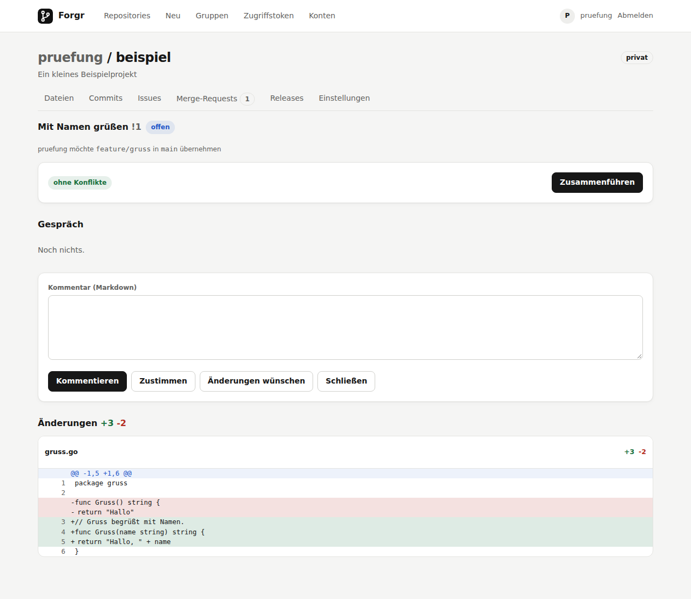

<p align="center"></p>
<h1 align="center">Forgr</h1>
<p align="center">Eigenes Git-Hosting mit Merge-Requests, Issues und CI-Status.</p>



## Was es kann

| Bereich | Funktionen |
|---|---|
| Git | HTTPS mit Zugriffstoken, Import von https, Dateien, Commits, Diffs, Blame |
| Merge-Requests | Review, Kommentare an Zeilen, Konfliktprüfung, Zusammenführen im Browser |
| Issues | Kommentare, Labels, Meilensteine |
| Releases | Tags mit Notizen, Quelltext als tar.gz |
| Rechte | lesen, schreiben, verwalten, für Konten und Gruppen |
| Anbindung | Webhooks, Commit-Status, Spiegel über https |

## Starten

```bash
cp .env.beispiel .env            # Kennwort für die Datenbank eintragen
docker compose up -d --build
docker compose logs forgr        # Link mit Einrichtungscode
```

Forgr läuft unter `http://<host>:8380`. Das erste Konto aus dem Link verwaltet
die App, bei OIDC trägt man den Admin in `FORGR_ADMIN` ein.

## CI-Status

```bash
curl -u name:token -d '{"name":"bau","zustand":"success"}' \
  https://host/api/repos/besitzer/repo/status/<voller Commit-Hash>
```

Zustände: `pending`, `success`, `failure`, `error`.

## Webhooks und Spiegel

Beides ist aus, bis es in der `.env` steht, siehe `.env.beispiel`. Webhooks
gehen nur an freigegebene Hosts. Spiegel überschreiben und löschen nichts.

## Grenzen

* Kein SSH, kein Git LFS, keine Container-Registry.
* Merge-Requests nur zwischen Zweigen eines Repositorys, Konflikte löst man lokal.

## Entwickeln

```bash
go test ./...
# mit Datenbank; sie wird geleert, der Name muss mit pruef beginnen
FORGR_TEST_DB=postgres://.../pruef_forgr go test ./...
```

Go 1.27.4, PostgreSQL 17. Lizenz: MIT, siehe [LICENSE](LICENSE).
